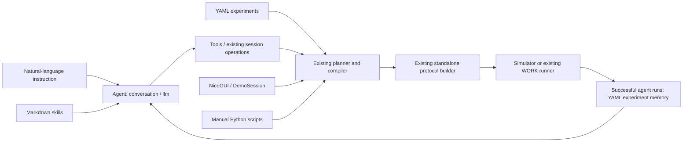

# Agent-centered architecture

The active application stays in `src/agents/dye_demo/`. Existing protocol families
and imports are retained rather than introducing another application framework.

| Component | Existing implementation / public surface |
| --- | --- |
| Agent | `conversation.py` interprets messages; `llm.py` connects the model; `session.py` coordinates a conversation |
| Tools | `tools.py` exposes YAML loading, compilation and standalone generation; `patches.py` implements existing edits |
| Skills | `skills/__init__.py` loads the same four root `skills/nanodrop-*/SKILL.md` files |
| Memory | `memory/__init__.py` records operator, date, run ID, configuration and summary in the existing YAML store |
| Workflow | `model.py`, `plan.py`, `references.py`, `compiler.py` resolve dilution and print instructions into operations |
| GUI | `gui/adapter.py` and `gui/app.py` reuse the terminal's `DemoSession` |
| Instrument | `SubprocessExecutor` calls existing builders/runners; `src/lab/robot_connection.py` owns robot discovery/configuration |

The shared compiler is the same function object used by session and manual tools.
The manual scripts call the existing `build_source` and simulator helpers and
write a new run directory, without replacing deployed or shared latest protocols.
Manual operations do not require an LLM or internet. No third liquid-handling
implementation has been introduced.

Existing edit controls, physical constraints and error reporting remain in place.
This organization adds no harness, approval gate, run gate or new validation
framework. Inactive earlier approval/run-gate patches remain inactive.

Configuration has three distinct roles: experiment YAML specifies operations;
existing machine/labware YAML and JSON describe laboratory hardware; HOME/WORK
launcher YAML selects the existing interface and backend. `.env` and ADC retain
authentication ownership. The launcher only overrides the model name for its
own process when explicitly configured; it writes no credentials or settings.

Memory remains a small single-writer YAML store. Saved history is operational
context, not a guarantee of physical state or successful scientific outcomes.
Manual previews/builds are artifacts rather than successful physical-run records.

This is a description of the implemented architecture, not a hardware
qualification claim. Serial well-to-well dilution is not implemented by
NanoDrop; the older `src/protocols/dilution.py` is a fixed-transfer example.
Other printing engines remain available through their original scripts.
Raman remains independent under `raman/`.
