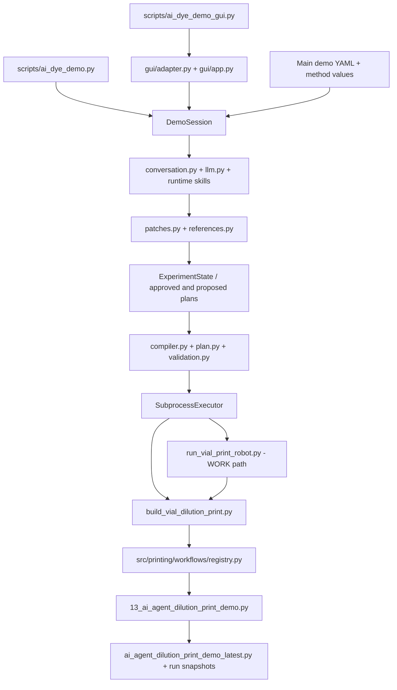

# Repository inventory and dependency map

## Baseline and evidence scope

Baseline: `1a4fd19a6b42c99bef639ca432a8b3d89a39ff37`, subject `before big update`,
2026-10-30. Starting branch `01_paper`; working tree was clean. The semantic
router/compiler/patch/reference modules, NanoDrop skills and associated new tests
are committed in this baseline. Their development date is not inferred from an
older report or a generated session timestamp.

`files.csv` records **1,196 tracked files**, with hashes and classifications.
No nonignored untracked source existed at the initial census. Review records are
excluded. The categories are conservative role assessments, not a claim to have
executed or individually proved the behavior of every file:

| Classification | Files | Meaning |
|---|---:|---|
| Active | 134 | NanoDrop implementation, primary executor/defaults/skills and associated docs/tests/tools |
| Shared | 855 | Supporting tooling, parallel workflows, independent Raman and reference data |
| Historical | 157 | Existing archives, experiment evidence and robot mirror records |
| Generated | 50 | Tracked generated protocol/config snapshots; some remain runner inputs |
| Unknown | 0 | All paths have a scope rule; this does not eliminate unresolved usage/qualification questions |

Top-level counts: source 238; tests 147; configs 142; scripts 44; skills 26;
Raman 330; archive 82; docs 62; experiment_01 29; robot_data 42; vision 10;
vision_tests 24; labware 7; examples 3; remaining root files 10.

Ignored/local artifacts are recorded separately in `local_artifacts.json`: names
only, not their contents, size, backup status or physical significance. This
includes `.env`, environments, caches, test outputs, photographs, session/run
records, experiment history and user YAML. Git internals are excluded. Do not
equate ignored with disposable. The actual WORK laptop is not accessible here.

## Current NanoDrop path

The diagram is conceptual dataflow, not a Python call graph. Editing is owned by
the session: it passes interpreted operations to `state.propose_patch()`, which
invokes the patch engine; the model/router never mutates state directly.



Confirmed by source inspection, not by launching the application:

- GUI launcher creates `DemoSession`, `LLMClient` and `SubprocessExecutor` and
  passes its adapter to NiceGUI. The terminal launcher uses the same session.
- Both model-backed launchers set `llm_first=not args.offline`. The session also
  retains legacy interpretation/grounding paths. No part is archival merely
  because the newer router exists.
- Primary default: `configs/workflows/defaults/ai_agent_dilution_print_demo.yaml`.
  Working copies: `configs/workflows/user/`. Session records: `runs/ai_dye_demo/`
  and `runs/ai_dye_demo_gui/`. Saved experiment memory: `experiment_history/`.
- Runtime NanoDrop skills are discovered under `skills/*/SKILL.md`, filtered by
  `domain: dye_demo`, `agent: nanodrop`, and ordered by their metadata.
- State compiles semantic sources and placement to an exact print map before
  normal session execution. The builder's independent raw-embedding path is a
  separate boundary for Task 1.3; this inventory does not repair it.
- `SubprocessExecutor.command()` selects the local builder for simulation and
  the robot runner for physical execution. Neither backend is called here.
- Registry builder version **19** selects filename prefix **13**, using Protocol
  API **2.15**. These numbers are different identifiers, not conflicting versions.
- Simulator preference uses `OT2_API_2_15_PYTHON` or
  `.venv/ot2-api-2.15-py310/python.exe`. Installed simulator environments must be
  retained; they are not test caches.
- The runner resolves robot identity via `src/lab/robot_connection.py` and
  `configs/robot.yaml`; uploads custom labware, creates/plays/monitors a run,
  and implements stop/status-file handling. No connectivity check is run here.
- Registry v19 is imageless. Camera workflows remain elsewhere; absence from
  v19 does not establish that their manual consumers are obsolete.

## Physical/configuration dependencies that must remain intact

| Item | Current consumers/importance | Decision |
|---|---|---|
| `configs/robot.yaml` | `robot_connection.py`, robot discovery and runners; identity and recorded capabilities | Retain exactly; no HOME attempt to update WORK observations |
| `src/core/config.py`, `.env` | GUI/terminal/provider construction; API-key HOME vs Vertex/ADC WORK, proxy/network settings | Retain; `.env` values are not inspected or recorded |
| `configs/machines/ot2_standard_printing_p20_v1.yaml` | Demo comparison and general printing profile | Retain separately from demo method values |
| Main demo YAML | P20, deck, air-gap/mix/release/tip choices | Preserve current behavior; no parameter consolidation |
| `labware/*.json`, `configs/labware/` | Protocol loading, geometry validation, labware catalogue/generator | Retain load names, namespaces and versions |
| `robot_data/` | Mirrored configuration/calibration/history plus paths used by current `Config`/utilities | Mixed evidence and runtime path use; not a cache directory |
| `.venv/ot2-api-2.15*` | Installed simulator dependencies | Retain until environment preservation is established |

The HOME files contain different plate-height choices between the demo and
general machine profile, plus historical notes about paper-release validation.
These are method distinctions/evidence questions, not permission to change a
height. Current WORK physical qualification cannot be inferred from this census.
The current demo's single-tip policy, return behavior and plate touch-tip cycle
must remain part of its future golden trace.

## Other maintained or historically supported paths

| Entry points / area | Dependencies | Inventory decision |
|---|---|---|
| `scripts/run_printing_workflow.py` | General standard/clover and other experiment loaders, builders, machine profiles, experiment YAML and frozen executors | Shared reusable engine; manual/no-agent path to preserve |
| `scripts/run_printing_experiment_robot.py` | Above plus helpers from `run_vial_print_robot.py`, connection and logging code; explicit experiment alias table | Separate WORK-capable consumer; no invocation here |
| `scripts/print_agent.py`, `src/agents/printing_agent.py` | Printing tools, schemas, workflow/design registries and runtime printing skills | Parallel scientific-intent frontend; not interchangeable with NanoDrop |
| `scripts/experiment_agent.py`, `scripts/11_experiment_agent.py` | Templates/generated YAML, v11 loader/builders, shared robot runner | Deferred replacement-review candidates, not unused files |
| `scripts/11_test_agent_configs.py`, `scripts/11_run_simulation_matrix.py` | v11 configs, offline parser, simulation matrix and `.test_tmp` | Existing verification tools; retain until equivalent coverage |
| `scripts/sers_agent.py`, `scripts/run_sers_experiment.py` | `src/sers_engine/` intent/schema/resolver/state/execution/provenance and SERS templates/profile | Separate composed-experiment system; reuse assessment before retirement |
| `src/agents/main.py`, vial specialist | Core workflow registry, tools, specialist modules; generic mock path deprecated | Compatibility frontends with consumers; retain until replaced |
| `scripts/generate_labware.py`, labware agent/tools | `src/labware/`, YAML catalogue, generated definitions and skills | Shared labware authoring/validation capability |
| `vision/`, `vision_tests/` | Camera/SSH acquisition, vision config, image studies and historical reports | Separate manual/research capability; not part of main demo execution |
| `raman/analyze_raman.py`, `raman/rename_raman_files.py`, other Raman reports | `raman/src/raman_lib/`, Raman configs, raw/plate/result records, numerical libraries | Independent analysis; preserve code/data conventions and own tests |
| `experiment_01/` | Ground-truth protocol/config/trace fixtures and staged audits used by tests/docs | Retain required fixtures and experimental evidence |

The general standard experiment schema already represents direct/serial
dilution, transfer, mix, print and delay. Its resolver/builder are consolidation
candidates. Its series-print tip restrictions and executor mechanics differ from
NanoDrop; this inventory does not declare them behaviorally equivalent.

## Dynamic dependencies and completeness limits

`references.csv` separates AST imports, literal-path/unique-filename references,
full textual path references and textual filename mentions. They are conservative
static evidence. A comment, docstring, test, historical audit or conditional import
is not proof that a path is called by the GUI. Multiple edges are not usage counts.
Neither literal matching nor AST inspection follows arbitrary code execution.

The following must be checked before any later archive move:

| Mechanism | Authority | Why simple import searches miss it |
|---|---|---|
| Builder protocol/version mapping | `src/printing/workflows/registry.py` | Source executors are selected from registered paths; deprecated entries remain buildable |
| Design mapping | `src/printing/designs/registry.py` | Four-clover and family behavior selected by registry/schema |
| Manual experiment aliases | `scripts/run_printing_experiment_robot.py:WORKFLOWS` | Named commands point to experiment/generated YAML dynamically |
| Generic workflow registration | `src/core/workflows/registry.py` | Printing/dilution/demo generators are still registered; austar/cleanup are explicit stubs |
| Robot protocol registration | `src/agents/robot_protocol_registry.py` | Manual/agent flags and runner protocol paths are separate from import reachability |
| Runtime skills | NanoDrop, `src/printing/skills.py`, `src/labware/skills.py` | Glob + metadata selects actual markdown bodies and declared references |
| Labware/config discovery | Labware tools/catalogue and workflow tools | Enumerated YAML remains user-visible without one direct consumer per file |
| Protocol source loading | Builders/geometry adapters, `importlib` loaders and subprocess strings | Files can be loaded by path rather than Python import |
| YAML includes/profile/template references | Printing/SERS/labware loaders | Runtime data relationships need loader-aware assessment |
| External/manual use and WORK-local choices | Operator procedures and current WORK environment | Not observable from HOME Git source alone |

Per-file decisions and the explicit candidate table are in `archive_assessment.md`.
No candidate is approved to move. All original archive manifests remain intact.

## Test and documentation observations deferred to later tasks

- Root `pytest.ini` collects `tests/` and excludes known archival/generated
  trees. Raman has separate tests; root collection is not evidence for Raman.
- `tests/test_gemini.py` performs model initialization/request at import. Do not
  run unguarded default test collection before Task 0.4 isolates it.
- The red-team harness constructs `SessionSettings` without enabling `llm_first`;
  its default is false. Historical campaigns do not establish current semantic
  router coverage. Task 1.5 addresses this.
- Existing top-level workflow guidance still emphasizes Workflow 01, while the
  main demo uses v19. Memory architecture notes still say "design only" although
  experiment history and NanoDrop runtime skills now exist. Record the drift;
  do not rewrite existing guides during inventory.
- Approval authorization, unified run gate, semantic builder enforcement,
  immutable upload artifacts and physical uncertainty remain subsequent tasks.
  No application test or physical acceptance is claimed here.

## Verification and restoration

Run the evidence-only generator/verifier from repo root using standard Python:

```powershell
python -B docs/reviews/task-0.1/generate_inventory.py
python -B docs/reviews/task-0.1/verify_inventory.py
```

These commands do not import repository modules or need OT-2/cloud libraries.
Application simulation/validation, when reached in later tasks, must use the `ai`
environment on HOME. Baseline tests/golden traces are not completed by these checks.

The verifier is scoped to this baseline snapshot: exact HEAD and original-file
hashes must match. A later documentation-only commit is expected to fail its HEAD
check; that does not invalidate preserved evidence or approve a new revision.
Future tasks need their own baseline-aware checks. Known-secret exclusions cover
`.env`, `keys` and `.aws`; this is not a general secret scanner.

Task 0.1 adds only review records on its dedicated branch. The original baseline
commit remains available. No backup/tag/commit, archive move or WORK rollout has
been performed by this task; Task 0.2 separately governs preservation/checkpoints.
